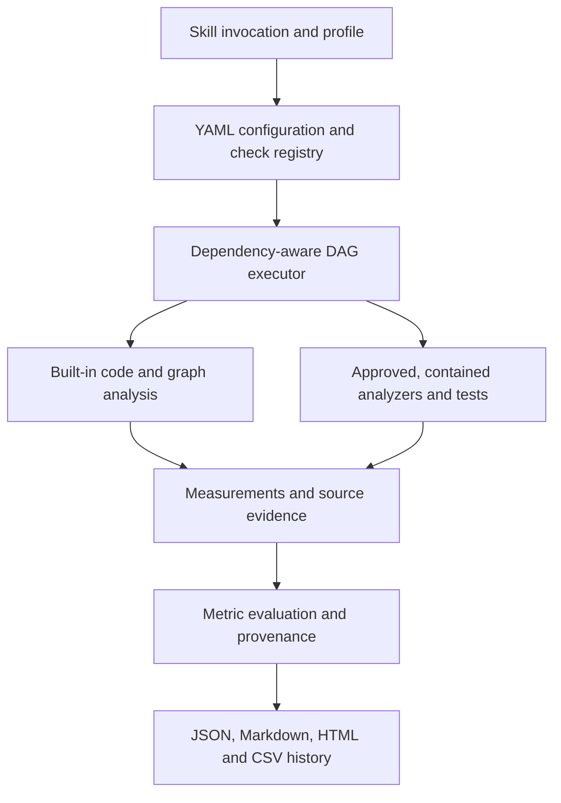

# Code Quality Auditor

**Evidence-driven code quality auditing for Cursor, Claude Code, and Codex.**

Code Quality Auditor is a reusable agent skill backed by a Python analysis engine. It evaluates repositories against **112 registered metrics** using configurable checks, source-code evidence, and a dependency-aware execution plan. It helps identify quality risks while distinguishing *confirmed failures* from *checks that could not be completed*.

- **Languages:** Python, JavaScript, TypeScript, and C++ (depth varies by language and available analyzers).
- **Checks:** syntax, architecture, maintainability, dependency and dead-code analysis, security, tests, coverage, duplication, requirements traceability, and selected quantitative-risk calculations.
- **Outputs:** JSON, Markdown, HTML, and optional CSV history.
- **Principle:** missing required evidence is **INCOMPLETE**, never silently PASS.

> **Execution limits:** By default, the skill reads source without running repository code or external analyzers. Those actions require explicit approval and working containment. The current containment implementation is macOS-only, with native enforcement still under verification. See [Security and limitations](docs/SECURITY.md).

## Quick start

**Prerequisite:** Python 3.12+.

1. Clone this repository and enter the canonical skill directory:

   ```bash
   git clone https://github.com/SergTogul/code-quality-auditor.git
   cd code-quality-auditor/.agents/skills/code-quality-auditor
   ```

2. Install the skill in your target project (choose **one** agent):

   ```bash
   # Cursor (default project installation)
   python scripts/auditor.py install --target /path/to/project --approve

   # Or Claude Code
   python scripts/auditor.py install --agent claude --scope project --target /path/to/project --approve

   # Or Codex
   python scripts/auditor.py install --agent codex --scope project --target /path/to/project --approve
   ```

3. Open the target project in the agent and invoke:

   | Agent | Skill invocation |
   | --- | --- |
   | Cursor | `/code-quality-auditor fast` |
   | Claude Code | `/code-quality-auditor fast` |
   | Codex | `$code-quality-auditor fast` |

   Omit the profile to select `full`. Skill discovery depends on the agent's supported skill paths; see [Installation and migration](docs/INSTALLATION.md).

**Direct engine invocation** (for development or diagnostics, from the skill directory):

```bash
python scripts/auditor.py audit --repo /path/to/project --profile fast
```

The command prints the overall decision and JSON report path; other report formats are written alongside it. By default, output is outside the audited repository. A non-PASS decision gives a nonzero command exit status. Built-in static analysis can run without permitting arbitrary project execution.

## What you get

The result includes selected metrics, measured values where available, source-linked findings, execution limitations, and a consolidated decision.

| Decision | Meaning |
| --- | --- |
| `PASS` | No confirmed blocking breach among the **selected and evaluated** checks |
| `FAIL` | At least one blocking metric breaches its threshold |
| `INCOMPLETE` | Mandatory evidence is unavailable, erroneous, or inconclusive |

For each confirmed blocking finding, the engine records source location, check and metric IDs, tool, revision, profile, configuration hash, observation, and evidence pointer.

**Example of how to inspect a generated report** (not a claimed audit result):

```bash
python scripts/auditor.py audit --repo /path/to/project --profile fast --out /tmp/cqa-report
python -m json.tool /tmp/cqa-report/report.json
```

The JSON includes a `decision`, `metrics`, `findings`, and `execution` details. Check actual output for measurements and `UNAVAILABLE` or `SKIPPED` statuses; no example counts are invented here.

## Choose a profile

| Profile | Intended use | Important behavior |
| --- | --- | --- |
| `fast` | Feedback during development | Changed-code scope; excludes mutation testing, semantic duplication, and performance benchmarks |
| `full` | Default repository assessment | All registered checks selected, subject to applicability and execution permissions |
| `expensive` | Deeper analysis | Larger time budget; includes expensive checks where available and authorized |
| `pr-review` | Pull request review | Changed-code scope; excludes mutation testing and performance benchmarks |
| `security` | Security-focused assessment | Selects configured security checks |

Profile selection does not override safety approvals. You can create custom profiles in YAML. For example, extend `fast` to exclude one additional check:

```yaml
version: 1
default_profile: fast
profiles:
  team-fast:
    extends: fast
    exclude:
      - performance_benchmarks
```

Use `python scripts/auditor.py explain-profile --profile fast` to inspect the effective selection. See [Configuration](docs/CONFIGURATION.md) for the registry and precedence model.

## How it works



The single canonical engine lives in `.agents/skills/code-quality-auditor/`. Its registry files are `config/metrics.yaml` (112 metrics), `config/checks.yaml`, `config/tools.yaml`, `config/policy.yaml`, `config/schema.yaml`, and `quality-auditor.yaml`. The DAG coordinates dependencies, concurrency, retries, and timeouts. Check availability depends on the language, environment, approvals, and toolchain.

## Customize and verify

- List registered checks: `python scripts/auditor.py checks`
- Validate catalogs and configuration: `python scripts/auditor.py validate`
- Initialize project configuration (write requires explicit approval): `python scripts/auditor.py init --repo /path/to/project --approve-write`
- Compare historical runs: `python scripts/auditor.py compare --history /path/to/history.csv --baseline RUN_A --current RUN_B`
- Run repository tests from the repository root: `python -m unittest discover -s tests -v`

CI runs Linux tests on supported Python versions and reports skipped platform-dependent tests explicitly. **Linux CI success is not native macOS sandbox verification.** See [Security and limitations](docs/SECURITY.md) and [macOS integration issue #10](https://github.com/SergTogul/code-quality-auditor/issues/10).

## Documentation

- [Installation, upgrades, and agent-specific paths](docs/INSTALLATION.md)
- [Profiles, YAML configuration, and metric registries](docs/CONFIGURATION.md)
- [Security model and known limitations](docs/SECURITY.md)
- [Requirements coverage](docs/REQUIREMENTS_COVERAGE.md)
- [Requirements v1.1](docs/requirements-v1.1.docx)

**Scope and honesty:** The 112 metrics are *registered*, not a guarantee that every metric can be measured on every repository. Missing data, unsupported platforms, or unapproved execution are surfaced in the report rather than presented as successful checks.
